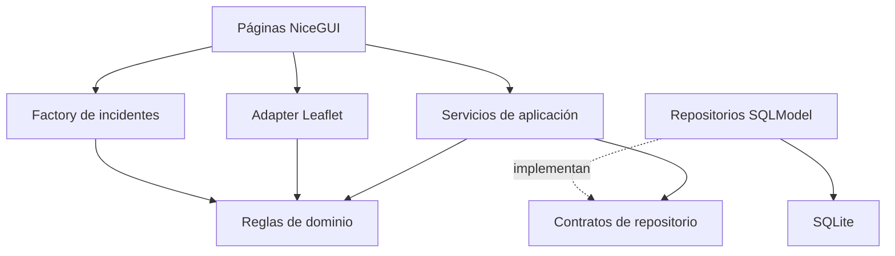

# Entrega final de EcoVinto

**Taller de Programación · Universidad Adventista de Bolivia**

EcoVinto permite que vecinos de Vinto registren incidentes ambientales con ubicación y fotografía. El personal administrador consulta los reportes, asigna responsables y documenta su avance. El panel reúne los estados, las categorías, las zonas con más reportes y el tiempo medio hasta la primera atención.

## Requisitos del MVP

| Requisito | Implementación y criterio observable |
|---|---|
| RF-01 Registro | El vecino registra categoría, descripción, fecha del hecho, contacto opcional y zona. |
| RF-02 Categorías | El selector y el Factory comparten un catálogo de ocho categorías. |
| RF-03 Ubicación | Leaflet convierte el clic en coordenadas válidas y muestra un marcador. |
| RF-04 Fotografía | JPG, PNG y WebP de hasta 5 MB y 20 megapíxeles. La app entrega la foto a usuarios autenticados. |
| RF-05 Consulta | Filtros por categoría, estado, fechas, zona y reportes propios. |
| RF-06 Estados | Reportado → En revisión → En atención → Atendido → Cerrado. Cada paso se valida antes de persistir. |
| RF-07 Responsables | El administrador asigna un responsable. Se exige desde En atención. |
| RF-08 Mapa | El panel ubica el conjunto de incidentes. El detalle ubica el reporte seleccionado. |
| RF-09 Indicadores | Totales, gráficos por categoría y estado, cinco zonas con más reportes y promedio hasta Atendido. |
| RF-10 Roles | El vecino registra y consulta. El administrador gestiona estados y usuarios. La app consulta el rol vigente. |

El tiempo de respuesta usa `creado` y `atendido_en`. SQLite conserva la primera marca de atención al cerrar el reporte. El panel muestra «Sin datos» hasta que haya reportes con ambas marcas.

## Arquitectura y patrones

EcoVinto usa un monolito modular. Las páginas NiceGUI recogen la entrada y muestran el estado. Los servicios coordinan los casos de uso y reciben los contratos de persistencia por constructor. Los repositorios SQLModel encapsulan las consultas y transacciones SQLite. El dominio concentra las coordenadas, los filtros, la validación y el cálculo de indicadores.

| Técnica | Aplicación |
|---|---|
| Factory | `IncidenteFactory.crear` verifica datos y entrega un objeto `DatosIncidente`. |
| Adapter | `LeafletAdapter` convierte eventos de mapa en coordenadas del dominio. |
| Repository | `IncidentRepository` y `UserRepository` implementan lectura y escritura con SQLModel. |
| Service Layer | `IncidentService` coordina reportes y atención. `AccountService` coordina autenticación, registro y roles. |
| SRP y DIP | Las vistas, reglas y consultas tienen responsabilidades distintas. Los servicios dependen de protocolos inyectados en `dependencies.py`. La aplicación conserva los modelos SQLModel para el intercambio con la persistencia. |
| Clean Code | El catálogo de categorías tiene una sola fuente y las reglas de transición quedan concentradas. |

## Seguridad en profundidad

- Autenticación con PBKDF2-SHA256, sal por cuenta y 600 000 iteraciones para hashes nuevos. Se conservó la lectura de hashes previos.
- Comprobación del usuario y el rol vigente en las rutas y acciones administrativas. La consulta de fotos requiere sesión y vínculo con un reporte.
- Configuración obligatoria de una clave de sesión y contraseña inicial. Se reemplaza la contraseña inicial antigua si la base todavía la usa.
- Validación de foto por tamaño, extensión, firma, formato y decodificación. El nombre almacenado es aleatorio. La foto se escribe al guardar el reporte.
- Consultas y actualizaciones parametrizadas mediante SQLModel. Un cambio simultáneo en un reporte se detecta antes de sobrescribirlo.

## Pruebas AAA

En las pruebas nuevas, **Arrange** establece los datos o una base de prueba, **Act** ejecuta el caso de uso y **Assert** verifica el resultado. La ejecución con `python -m pytest -q` incluye **25 pruebas**. Las primeras 17 comprueban reglas de dominio y validación de firmas. Las 8 nuevas comprueban cuentas, permisos, persistencia de reportes con foto y filtros, recuperación al fallar el guardado, atención secuencial, migración de SQLite, compatibilidad de contraseñas e imágenes dañadas.

## Bitácora de Vibe Coding

| Solicitud real | Cambio asistido | Verificación |
|---|---|---|
| Continuar la auditoría de EcoVinto sobre el ZIP de fase 1 | Se inventariaron rutas, modelos, pruebas y evidencias previas. | Se ejecutaron las 17 pruebas existentes al integrar los cambios. |
| «Chat Terminemos Ecovinto con todo lo avanzado en taller de programación.» | Se integraron servicios, repositorios, controles de sesión, fotos, pruebas AAA y documentación. | Se ejecutaron pruebas de dominio e integración con SQLite y archivos temporales. |
| «Crear repositorio público» | Se creó el repositorio EcoVinto para publicar el proyecto. | Se comprobó su visibilidad pública desde GitHub. |

## Demostración

En la [guía de demostración](../GUIA_DEMO_Y_CAPTURAS.md) se detalla el recorrido para vecino y administrador. El [README](../README.md) explica el inicio local, el uso con Docker y la configuración de la base.
